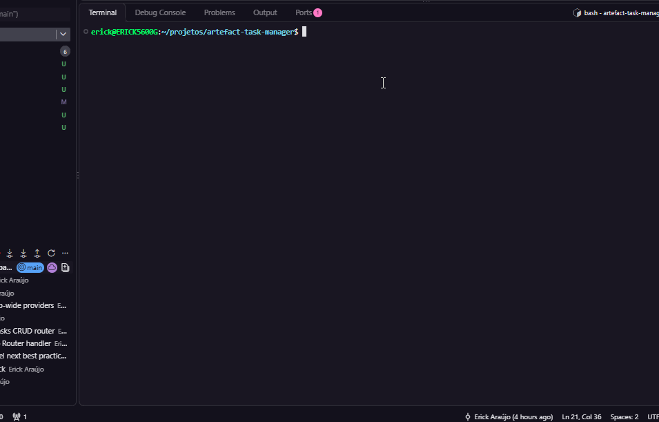

# Artefact Task Manager



A task manager built with Next.js, tRPC, TanStack Query, Zod, and an in-memory store.

## Overview

The application lists, creates, edits, and deletes tasks. The task list is a Server Component rendered on every request; the create/edit form and the delete control are Client Components that call the same tRPC router. Server Components use an in-process caller, while the browser uses `/api/trpc` over HTTP.

Tasks are stored in a `Map` inside the Node.js process. There is no database, authentication, or persistence layer.

**Stack**

- Next.js 15 (App Router, React Server Components, Turbopack)
- React 19
- tRPC 11 with `@trpc/tanstack-react-query`
- TanStack Query 5
- Zod 4
- Tailwind CSS 4
- TypeScript 5
- Node.js 22 and npm

## Getting Started

Prerequisites: Node.js 22 and npm. No database or environment variables are required.

```bash
npm install
npm run dev
```

Open http://localhost:3000.

Additional scripts:

```bash
npm run lint    # ESLint
npm run build   # production build; also type-checks
npm start       # serve the production build
```

Stop the dev server before running `npm run build`: both commands write to `.next`, and a build during development can leave the dev server serving stale or failing output.

## Design Decisions & Trade-offs

**In-memory store.** `src/server/task-store.ts` keeps a `Map<string, Task>` on `globalThis`. Within one Node.js process this survives Turbopack hot reloads and gives the route handler and RSC bundles the same data, so the design requires the app to run as a single long-running Node process. The trade-off is process-local state: tasks are lost on restart, not shared between instances, and not persisted. On a serverless platform the page and the route handler run in separate instances with separate memory. This was verified against the serverless deployment used for this test: `tasks.create` returned `200` and `tasks.list` from the API route returned the new task, but repeated server-rendered page loads never showed it — a task created through HTTP is not visible to the server-rendered list.

**Use of `force-dynamic`.** The list is marked `dynamic = "force-dynamic"` so Next.js renders it on every request. Without it, Next.js would prerender the page at build time and serve that frozen snapshot; tasks created at runtime would never appear. The trade-off is a server render per request instead of a cached static page, which is the right exchange for mutable, process-local state.

**SSR through the tRPC server caller.** Server Components call `createCallerFactory(appRouter)` in `src/trpc/server.ts` instead of fetching `/api/trpc`. The data is available before HTML is sent, with no extra HTTP hop. The trade-off is two entry paths into one router (in-process and HTTP), which must remain behaviorally identical; sharing the router keeps them aligned.

**Shared Zod schemas.** `src/lib/tasks.ts` defines the input schemas used by both `TaskForm` and the router. The browser validates for immediate feedback; the server validates again as the trust boundary. The trade-off is running the same validation twice and keeping `src/lib` free of server-only imports.

**ISO date strings.** No tRPC transformer is configured, so `createdAt` is typed and transported as an ISO 8601 string. This keeps the client type truthful. The trade-off is that consumers construct a `Date` before formatting.

**Minimal custom toast.** `src/components/toast.tsx` implements the provider, four-second timers, and an `aria-live` viewport, mounted in the root layout so a toast survives the deleted row's unmount. The trade-off is fewer features than a toast library: no queue policies, stacking limits, or variants.

**Server-rendered list with refresh after writes.** Mutations do not update a client-side list cache. Create/update navigate to `/`, and delete calls `router.refresh()`, causing the dynamic page to re-run against the store. The trade-off is a server render per change instead of an optimistic update; it also avoids duplicating list state in TanStack Query and avoids date-hydration mismatches.

**Root providers and a type-only router import.** `TRPCReactProvider` and `ToastProvider` are mounted once in `src/app/layout.tsx`. `src/trpc/client.tsx` imports `AppRouter` with `import type`, keeping routers, the store, and `node:crypto` out of the browser bundle.


## Project Structure

The code is grouped by responsibility: routes live in `src/app`, client UI in
`src/components`, shared types and schemas in `src/lib`, server-only state in
`src/server`, and tRPC wiring in `src/trpc`.

<details><summary>Project tree</summary>

```text
artefact-task-manager/
├── src/                                # Application source
│   ├── app/                            # Next.js App Router: pages and routes
│   │   ├── layout.tsx                  # Root layout: mounts tRPC + toast providers
│   │   ├── page.tsx                    # /                 task list (SSR, per request)
│   │   ├── globals.css                 # Tailwind CSS entry
│   │   ├── api/                        # HTTP endpoints
│   │   │   └── trpc/[trpc]/route.ts    # /api/trpc         tRPC handler (GET + POST)
│   │   └── tasks/                      # Task routes
│   │       ├── new/page.tsx            # /tasks/new        create task
│   │       └── [id]/edit/page.tsx      # /tasks/:id/edit   edit task (404 if missing)
│   │
│   ├── components/                     # Client Components
│   │   ├── task-form.tsx               # Create/edit form with inline validation
│   │   ├── delete-task-button.tsx      # Delete control: pending + error state
│   │   └── toast.tsx                   # Toast provider, viewport, useToast hook
│   │
│   ├── lib/                            # Shared by server and client
│   │   └── tasks.ts                    # Task type + Zod input schemas
│   │
│   ├── server/                         # Server-only (never imported by client code)
│   │   └── task-store.ts               # In-memory Map store
│   │
│   └── trpc/                           # tRPC wiring
│       ├── init.ts                     # Initialization, context, base procedure
│       ├── routers/
│       │   ├── tasks.ts                # Task procedures (list, byId, create, update, delete)
│       │   └── _app.ts                 # Root router + AppRouter type
│       ├── client.tsx                  # Browser provider + useTRPC hook
│       ├── server.ts                   # In-process caller for Server Components
│       └── query-client.ts             # TanStack QueryClient factory
│
├── package.json                        # Scripts and dependencies
├── next.config.ts                      # Next.js configuration
├── tsconfig.json                       # TypeScript config + @/* path alias
├── eslint.config.mjs                   # ESLint configuration
├── postcss.config.mjs                  # PostCSS configuration
├── AGENTS.md                           # Project guidance for agents
└── README.md                           # This document
```
</details>


Two entry paths into the same router:

```text
Server Components ── in-process caller ──┐
                                         ├──► tRPC router ──► in-memory store
Client Components ── /api/trpc (HTTP) ───┘
```

Server Components read through `src/trpc/server.ts` without an HTTP hop; Client
Components go through the route handler in `src/app/api/trpc/[trpc]/route.ts`.
Both use the same procedures, so behavior stays identical — only the transport
differs.

## API Reference

The router is exposed at `/api/trpc`. Queries use GET and mutations use POST. tRPC maps `BAD_REQUEST` to HTTP 400 and `NOT_FOUND` to HTTP 404.

| Procedure | Type | Input | Behavior | Errors |
| --- | --- | --- | --- | --- |
| `tasks.list` | query | none | Returns all tasks sorted newest first by `createdAt`. | none |
| `tasks.byId` | query | `{ id: string }` (UUID) | Returns the matching task. | `BAD_REQUEST` for an invalid UUID; `NOT_FOUND` when no task exists. |
| `tasks.create` | mutation | `{ title: string, description?: string }` | Trims both fields, requires a non-empty title, stores a task with a generated UUID and ISO timestamp, and returns it. | `BAD_REQUEST` for an invalid payload or empty title. |
| `tasks.update` | mutation | `{ id: string, title: string, description?: string }` | Replaces the title and description and returns the updated task. | `BAD_REQUEST`; `NOT_FOUND`. |
| `tasks.delete` | mutation | `{ id: string }` (UUID) | Deletes the task and returns `{ id }`. | `BAD_REQUEST`; `NOT_FOUND`. |

Task shape:

```ts
type Task = {
  id: string;
  title: string;
  description?: string;
  createdAt: string; // ISO 8601
};
```

Validation messages are "Title is required.", "Invalid task ID.", and "Task not found.".

## Frontend Behavior

**Task list (SSR).** `src/app/page.tsx` is a Server Component, it obtains a caller with `getServerCaller()` and calls `tasks.list()` in-process, so the HTML response already contains the tasks; the browser does not request the list. Rows show the title, optional description, creation time (formatted with `Intl.DateTimeFormat`, `en-US`), and Edit and Delete controls. The header shows the task count or "No tasks yet."; an empty store renders "Tasks you create will appear here."

**Create and edit form.** `TaskForm` is a Client Component shared by `/tasks/new` and `/tasks/[id]/edit`. Inputs are controlled, and the form uses `noValidate` plus `createTaskInput.safeParse` on submit. Title errors appear below the field with `aria-invalid` and `aria-describedby`; other validation issues and server failures appear in a form-level `role="alert"`. While a mutation is pending, the submit button is disabled and reads "Creating…" or "Saving…". Success navigates to `/`, where the dynamic page re-renders from the store. The edit page loads the task with `byId`; an invalid or missing id renders the Next.js not-found page. Cancel and back links return to the list without saving.

**Delete feedback.** Each row has a `DeleteTaskButton`. While the mutation is pending, the button is disabled and reads "Deleting…". Success shows a toast (`Deleted "<title>".`) from the root-level `ToastProvider` and calls `router.refresh()`, which re-renders the server list; the toast dismisses after 4 seconds and the viewport uses `aria-live="polite"`. Failure leaves the row in place and shows the server message inline with `role="alert"`; unexpected errors use a generic fallback.

**Loading, success, and error states.** The initial list has no loading state because it is server-rendered. Create/edit and delete expose pending states on their controls. Success is a navigation (create/update) or a toast plus refreshed list (delete). Client-side validation errors are inline and make no request; API errors are shown inline in the form or under the delete button.

## Limitations

- Tasks are process-local and in memory: restarting the server clears them, and multiple instances do not share state.
- There is no authentication or per-user isolation; every client sees the same tasks.
- There is no pagination; `tasks.list` returns the full collection and the page renders every row.
- The task model is limited to title, optional description, and creation time.
- There is no concurrency control; simultaneous updates follow last-write-wins.
- There are no automated tests; verification is manual plus `npm run lint` and `npm run build`.

## Bonus / Next Steps

Infinite scroll is not implemented. The list is rendered in a single server pass from the full result of `tasks.list`. Adding it would move paging state into the client, which conflicts with the current server-rendered list and the post-delete `router.refresh()`. A correct implementation would require paginated or cursor-based input on `tasks.list`, a client-side list hydrated through `HydrationBoundary`, and cache invalidation of the list query after create/update/delete instead of `router.refresh()`.

## Manual Test Checklist

Start from a fresh process so the store is empty: `npm install && npm run dev`, then open http://localhost:3000.

**Create**

1. Click "New task", enter a title and a description, and submit with "Create task".
2. Verify the app returns to `/`, the task appears at the top, the count increases, and the description and creation time are shown.

**Validation**

3. Open "New task", leave the title empty, and submit. Expect "Title is required." below the field and no navigation.
4. Enter a title containing only spaces and submit. Expect the same error; input is trimmed before the minimum-length check.
5. Start typing in the title. Expect the error to clear.
6. Submit a valid title with an empty description. Expect a task without a description paragraph.

**List**

7. Create several tasks and verify newest-first order, the singular/plural count ("1 task" / "N tasks"), and Edit and Delete controls on every row.
8. Restart the dev server and reload. Expect an empty list, because tasks are held in memory.

**Update**

9. Click Edit on a task, change the title or description, and click "Save changes".
10. Verify the list shows the updated values and the original creation time.
11. Click Edit and then Cancel; verify the list is unchanged.
12. Visit `/tasks/not-a-uuid/edit` and `/tasks/<random-uuid>/edit`. Both should render the Next.js 404 page.

**Delete**

13. Click Delete on a row. The control is disabled and reads "Deleting…" while the request is pending (it may complete too quickly to observe locally).
14. Verify the row disappears, the count updates, and the toast `Deleted "<title>".` appears for about 4 seconds.

**Error states**

15. Open `/` in two tabs. Delete a task in tab A, then click Delete on the same row in tab B. Expect the inline alert "Task not found."; the row stays until the page is refreshed.
16. Open `/tasks/<id>/edit` in two tabs. Delete the task in tab A, then save in tab B. Expect the form-level alert "Task not found." and no navigation.

**Final checks**

17. Run `npm run lint` and `npm run build` with the dev server stopped.
